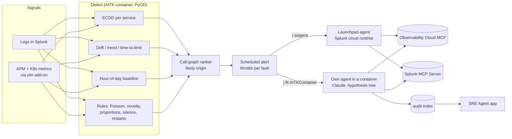

# Splunk AITK Launchpad based SRE Agent

An AI SRE (site reliability engineering) agent built on the **Splunk AI Toolkit (AITK) 6.2** — its Agent Launchpad,
its container framework (DSDL, Data Science and Deep Learning) and its ML (machine learning) algorithms — together
with **Splunk Observability Cloud** and the **Splunk MCP (Model Context Protocol) Server**.

It covers the whole loop: **detect** an anomaly with ML models, **investigate** it with an LLM (large language model)
agent that reads metrics, traces and logs through MCP tools, **propose** one action for a human to approve, and
**show** every investigation in a Splunk app.

**📖 Read the full write-up with diagrams and results: https://khsydney.github.io/splunk-aitk-launchpad-sre-agent/** (source: `docs/index.html`)

> All results below come from a **simulated** payment platform ("TukTukPay", a lab with injected faults). Latencies,
> errors and payments are not real. Treat the numbers as a lab benchmark, not a production claim.



## Quick start

A working agent in about 30 minutes: **0 check → 1 tool connections → 2 agent → 3 ask it**, then optionally let
alerts start it (4, 5). Scripts run on your laptop (Python 3.9+, standard library only) against Splunk Web's REST
API, and every step is safe to re-run. Details and troubleshooting: **[GETTING_STARTED.md](GETTING_STARTED.md)**.

### Before you start (once, in Splunk Web)

- **AI Toolkit 6.2+** with Python for Scientific Computing, and **Splunk Cloud Connect** linked to a Splunk Cloud tenant (Launchpad agents run in Splunk's cloud runtime).
- An **LLM connection** (AI Toolkit → Connections → + Connection): Splunk-hosted GPT-OSS 120B, or Anthropic **Claude Sonnet 4.5** — *not* Claude 5.5, which Launchpad's runtime cannot call.
- Role **`mltk_admin`** on your user; an **Observability Cloud API token**.
- Recommended: the **Splunk MCP Server** app with a token for a read-only user (gives the agent your logs). Step 5 also needs the **Infrastructure Monitoring Add-on**.

### 1. Configure

```bash
git clone https://github.com/khsydney/splunk-aitk-launchpad-sre-agent.git && cd splunk-aitk-launchpad-sre-agent
cp config.env.example config.env                       # then edit it (git-ignored)
printf 'admin\nYOUR_PASSWORD\n' > ~/.splunk_creds && chmod 600 ~/.splunk_creds
printf 'YOUR_O11Y_API_TOKEN\n'  > ~/.o11y_token    && chmod 600 ~/.o11y_token
```

Set at least `SPLUNK_WEB_URL`, `O11Y_REALM`, `O11Y_ENVIRONMENT`, `LOG_INDEX`, `LLM_CONNECTION` / `LLM_PROVIDER` /
`LLM_MODEL` (exactly as on your LLM connection) and `AGENT_NAME` (letters and digits only).

### 2. Run the steps

| Step | Command | You should see |
|---|---|---|
| **0 · Check** | `python3 quickstart/00_check.py` | every line ✓ — each ✗ prints its fix |
| **1 · Tools** | `python3 quickstart/01_mcp_connections.py` | `✓ created o11y_cloud with 41 tools` (+ `splunk_logs` if configured) |
| **2 · Agent** | `python3 quickstart/02_agent.py` | `✓ created agent SREAgent: 15 tools …` · `✓ agent is Available` |
| **3 · Ask it** | `python3 quickstart/03_ask_agent.py "Why is checkout slow?"` | the answer, its tool calls and the time (1–5 min) |
| 4 · Detector alerts → agent *(optional)* | `python3 quickstart/04_alert.py` then `--enable` | alert saved DISABLED; detector alerts found in your index |
| 5 · ML anomalies → agent *(optional)* | `python3 quickstart/05_ml_detection.py account` · `train 24` · `alert` · `enable` | `| sim flow` returns data; 3 models trained; alert saved |

Step 4 needs an Observability Cloud **Splunk platform** notification integration sending detector alerts to your
Splunk (HEC). Step 5 trains on hours you know were **normal**.

Tested end to end on Splunk Enterprise 10.6 with AI Toolkit 6.2 (28 Oct 2026): the test agent answered a health check
in 56 s with live numbers and no failed tool calls.

## What is in here

| Folder | What |
|---|---|
| `quickstart/` | **The supported path**: numbered steps driven by `config.env`, each one idempotent and checked |
| `agent-container/` | Our **own agent runtime inside an AI Toolkit container** (`| fit AITKContainer algo=tuktuk_sre`): Claude Sonnet/Opus 5.5 with thinking, escalation, evidence checks, approval policy, optional sub-agent hypothesis tree |
| `detection-modules/` | Five **anomaly detectors as AI Toolkit container modules** (ECOD, drift and time-to-limit, hour-of-day baseline, statistical rules, Isolation Forest) with a coverage test of 11 fault types |
| `splunk-app/` | **TukTukPay SRE Agent** Splunk app: case list, conclusion card, hypothesis tree, sub-agent timeline, evidence, agent trace |
| `docs/` | Write-up with diagrams and results — published at https://khsydney.github.io/splunk-aitk-launchpad-sre-agent/ |
| `research/` | The original lab scripts (dated, tied to the lab environment): tuning harness, method tests, act tests, model bake-off |
| `lib/` | `stack.py` (Splunk Web session + REST + search), `config.py` (reads `config.env`), `mcp.py` (minimal MCP client) |

## Results from the lab (simulated faults)

**Runtimes** (where the agent loop runs):

| Option | Models | Result |
|---|---|---|
| Launchpad (Splunk cloud runtime) | Splunk-hosted GPT-OSS 120B, Claude Sonnet 4.5 | Works. Claude Sonnet / Opus 5.5 fail: the runtime always sends `thinking: {"type": "disabled"}`, which those models reject (HTTP 400) |
| Launchpad + LiteLLM gateway | any | Translation works on the host; end to end needs a public endpoint for the runtime, and custom LLMs are documented as unsupported for agents |
| **Own agent in an AITK container** | Claude Sonnet → Opus 5.5 with thinking | Works end to end from one SPL line; e.g. correct root cause in 74 s for USD 0.33 |

**Hypothesis tree** (Datadog Bits AI SRE style): as instructions in Launchpad (Sonnet 4.5) it scored 4/5 against 5/5 for
a tuned checklist; as parallel sub-agents with code-checked verdicts in our agent it ran concurrently (all branches of
a level start together) but scored 7/9 against 9/9 offline and was fooled once by a leftover signal. Default stays the
single loop; the tree is available per call (`method="tree"`).

**Detection**: the live alert flagged all 8 lab faults within the first minute (detectors 24–181 s later). In a bake-off
on the same data, ECOD, COPOD and One-Class SVM reached 1.4 false alarms/day against 24 for per-signal thresholds; the
best origin ranker was the call graph + ECOD score (origin ranked first in 6 of 8). A coverage test with 11 injected
fault types (spikes, slow ramps, memory leaks, level shifts, daily-pattern breaks, decoupled signals, quiet-service
errors, new error types, business ratios, silence, restarts) is caught by the five modules with 0 false alarms on a
clean day (`detection-modules/tests/test_coverage.py`).

## Things we learned about the platform

- **Launchpad + Claude 5.5:** fixed `thinking: disabled` in the cloud runtime → use Sonnet 4.5, or run your own agent in a container. The connection *test* passes anyway (it runs on the search head).
- **Anthropic connections** keep their endpoint only if set at creation; editing later drops it ("Connection error").
- **Agent names** must be letters and digits only (a hyphen gives a bare "Failed to create agent"; the reason is in `mlspl.log`).
- **"Run AI Agent" alert action** does not pass result fields: `$result.x$` inside its prompt is never expanded. End the scheduled search in `| aiagent prompt="… {field} …"` instead (fills `{field}` from the row) and throttle in SPL.
- **DSDL example notebooks** (`anomaly_detection_ecod`, `random_cut_forest`, `autoencoder`) are templates, not detectors (one feature; broken `load()`; always flags 1 %; no scaling). The libraries in the image (PyOD, scikit-learn, statsmodels, Prophet) are what is useful.
- **Splunk Web's Bootstrap** styles `.alert`, `.muted`, `.label`, `.btn` — prefix your own class names in custom views.

## Status and limits

Built and tested in a lab over a few days; not production-hardened. The detection modules were trained on short
baselines; seasonal coverage starts with an hour-of-day baseline (Prophet needs weeks of data). Actions are only ever
proposed — a human approves.
