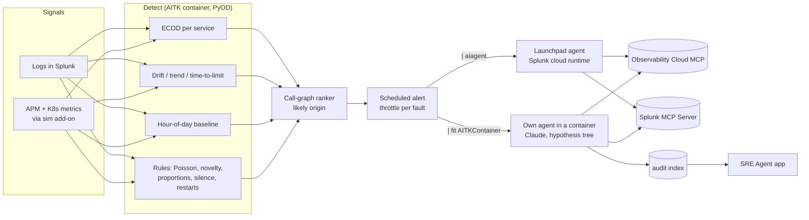

# Splunk AITK Launchpad based SRE Agent

An AI SRE (site reliability engineering) agent built on the **Splunk AI Toolkit (AITK) 6.2** — its Agent Launchpad,
its container framework (DSDL, Data Science and Deep Learning) and its ML (machine learning) algorithms — together
with **Splunk Observability Cloud** and the **Splunk MCP (Model Context Protocol) Server**.

It covers the whole loop: **detect** an anomaly with ML models, **investigate** it with an LLM (large language model)
agent that reads metrics, traces and logs through MCP tools, **propose** one action for a human to approve, and
**show** every investigation in a Splunk app.

> All results below come from a **simulated** payment platform ("TukTukPay", a lab with injected faults). Latencies,
> errors and payments are not real. Treat the numbers as a lab benchmark, not a production claim.



## What is in here

| Folder | What | Notes |
|---|---|---|
| `launchpad/` | Create and tune an **Agent Launchpad** agent: Observability Cloud MCP connection, Splunk MCP connection, the agent (hosted model or Anthropic), an alert that runs it, a tuning harness, side-by-side comparison and method tests | Python, talks to Splunk Web's REST API with `lib/stack.py` |
| `agent-container/` | Our **own agent runtime inside an AITK container**: `| fit AITKContainer algo=tuktuk_sre` runs the agent (Claude with thinking, escalation, evidence checks, approval policy, optional sub-agent hypothesis tree) and returns the answer as search columns | Image based on `splunk/mltk-container-golden-cpu`; agent in a Python 3.11 venv |
| `detection/` | **Anomaly detection that starts the agent**: the scheduled alert, the Infrastructure Monitoring add-on setup (`| sim flow`), live act tests, a model bake-off and the five **DSDL modules** (`modules/`) | Modules: `tuktuk_ecod`, `tuktuk_iforest`, `tuktuk_drift`, `tuktuk_seasonal`, `tuktuk_rules` |
| `splunk-app/` | **TukTukPay SRE Agent** Splunk app: case list, conclusion card, Datadog-style hypothesis tree (tree / selected hypothesis), sub-agent timeline, evidence with links, agent trace | Custom HTML/JS view; read-only |
| `docs/` | Write-up with architecture diagrams and results (`agent-runtime-options.html`), the detection coverage plan, the sub-agent tree plan | |
| `lib/stack.py` | Splunk Web session helper (form login, web-proxied REST, search) | env: `SPLUNK_WEB_URL`, `SPLUNK_CREDS_FILE`, `SPLUNK_VERIFY_TLS` |

## Requirements

- Splunk Enterprise 10.x (or Splunk Cloud) with **AI Toolkit 6.2**, Python for Scientific Computing, **Splunk Cloud Connect** (Launchpad agents run in Splunk's cloud runtime), the **Splunk MCP Server** app, and the **Splunk Infrastructure Monitoring Add-on** for `| sim flow`.
- Splunk Observability Cloud (APM, Kubernetes) and its MCP gateway.
- Docker on a host the search head can reach, for the AITK containers.
- An Anthropic API key for the container agent (optional for Launchpad, which can use Splunk-hosted models).

Credentials are never in this repo: scripts read a credentials file (`SPLUNK_CREDS_FILE`) and tokens from the environment (`SPLUNK_O11Y_TOKEN`, `ANTHROPIC_API_KEY`). Container secrets go in an env file outside the image.

## Quick start (outline)

```bash
export SPLUNK_WEB_URL=https://splunk.example.com:8000 SPLUNK_CREDS_FILE=~/.splunk_creds SPLUNK_O11Y_TOKEN=...
# 1. Launchpad agent with Observability Cloud + Splunk MCP tools
python3 -I launchpad/setup-aitk-o11y-mcp.py && python3 -I launchpad/setup-aitk-splunk-mcp.py && python3 -I launchpad/setup-aitk-agent.py
# 2. Detection modules (build on the Docker host), register the container in AITK, train, then the alert
docker build -t anomaly-aitk detection/modules
docker run --rm --network none -v $PWD/detection/modules:/work:ro --entrypoint python3 anomaly-aitk /work/tests/test_coverage.py
python3 -I detection/setup-ml-anomaly-alert.py          # created disabled; `enable` when tested
# 3. Own agent in a container (optional)
docker build -t sre-agent-aitk -f agent-container/aitk-container/Dockerfile agent-container
# 4. The Splunk app
tar --no-xattrs -czf sre-app.tgz -C splunk-app tuktukpay_sre_agent && splunk-app/install-sre-app.sh sre-app.tgz
```

Most scripts are one-off and idempotent; read each file's header first. Environment names (`tuktukpay-demo`), service
names and the call graph are those of the lab — change them for your platform.

## Results from the lab (simulated faults)

**Runtimes** (where the agent loop runs):

| Option | Models | Result |
|---|---|---|
| Launchpad (Splunk cloud runtime) | Splunk-hosted GPT-OSS 120B, Claude Sonnet 4.5 | Works. Claude Sonnet / Opus 5.5 fail: the runtime always sends `thinking: {"type": "disabled"}`, which those models reject (HTTP 400) |
| Launchpad + LiteLLM gateway | any | Translation works on the host; end to end needs a public endpoint for the runtime, and custom LLMs are documented as unsupported for agents |
| **Own agent in an AITK container** | Claude Sonnet → Opus 5.5 with thinking | Works end to end from one SPL line; e.g. correct root cause in 74 s for USD 0.33 |

**Hypothesis tree** (Datadog Bits AI SRE style): as instructions in Launchpad (Sonnet 4.5) it scored 4/5 against 5/5 for
a tuned checklist; as parallel sub-agents with code-checked verdicts in our agent it ran concurrently (all branches of
a level start together) but scored 7/9 against 9/9 offline and was fooled once by a leftover signal. Default stays the
single loop; the tree is available per call (`method="tree"`).

**Detection**: the live alert flagged all 8 lab faults within the first minute (detectors 24–181 s later). In a bake-off
on the same data, ECOD, COPOD and One-Class SVM reached 1.4 false alarms/day against 24 for per-signal thresholds; the
best origin ranker was the call graph + ECOD score (origin ranked first in 6 of 8). A coverage test with 11 injected
fault types (spikes, slow ramps, memory leaks, level shifts, daily-pattern breaks, decoupled signals, quiet-service
errors, new error types, business ratios, silence, restarts) is caught by the five modules with 0 false alarms on a
clean day (`detection/modules/tests/test_coverage.py`).

## Things we learned about the platform

- **Launchpad + Claude 5.5:** fixed `thinking: disabled` in the cloud runtime → use Sonnet 4.5, or run your own agent in a container. The connection *test* passes anyway (it runs on the search head).
- **Anthropic connections** keep their endpoint only if set at creation; editing later drops it ("Connection error").
- **Agent names** must be letters and digits only (a hyphen gives a bare "Failed to create agent"; the reason is in `mlspl.log`).
- **"Run AI Agent" alert action** does not pass result fields: `$result.x$` inside its prompt is never expanded. End the scheduled search in `| aiagent prompt="… {field} …"` instead (fills `{field}` from the row) and throttle in SPL.
- **DSDL example notebooks** (`anomaly_detection_ecod`, `random_cut_forest`, `autoencoder`) are templates, not detectors (one feature; broken `load()`; always flags 1 %; no scaling). The libraries in the image (PyOD, scikit-learn, statsmodels, Prophet) are what is useful.
- **Splunk Web's Bootstrap** styles `.alert`, `.muted`, `.label`, `.btn` — prefix your own class names in custom views.

## Status and limits

Built and tested in a lab over a few days; not production-hardened. The detection modules were trained on short
baselines; seasonal coverage starts with an hour-of-day baseline (Prophet needs weeks of data). Actions are only ever
proposed — a human approves.
